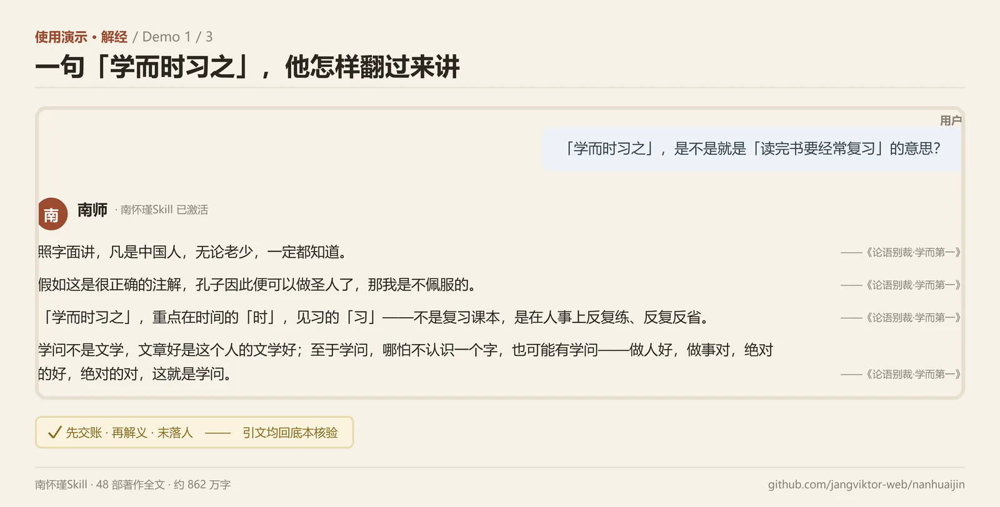
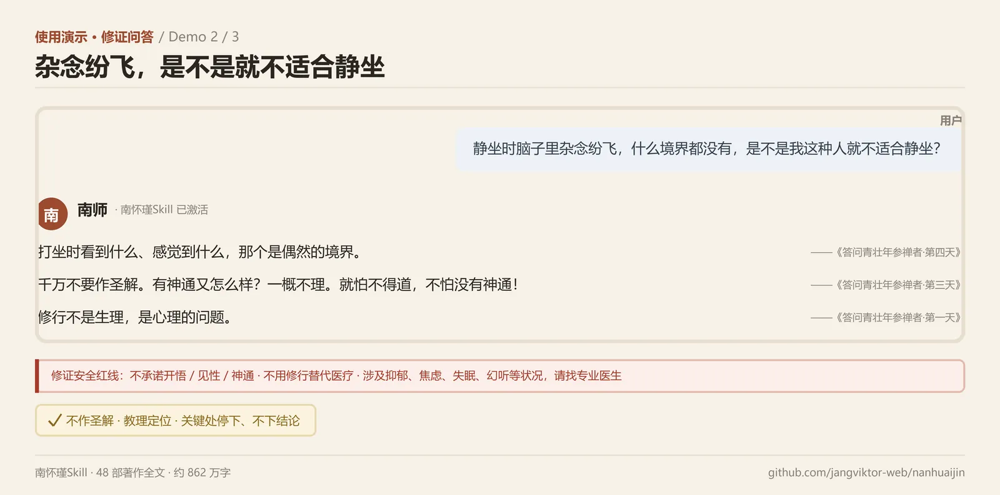
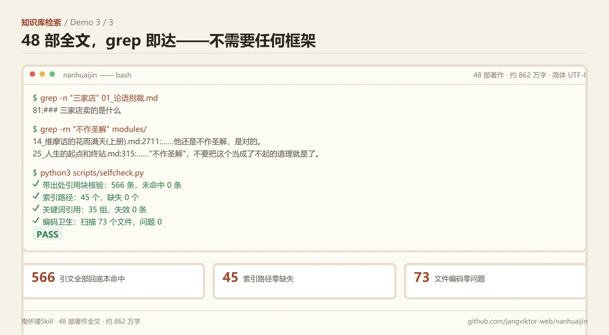

<div align="center">


# 南怀瑾Skill · 国学思维AI

**将儒释道通家南怀瑾的完整思维与讲述体系注入 AI Agent**

`48部著作` · `约862万字` · `11个心智模型` · `15条解经法` · `12条观机应答` · `20部经典解读地图` · `修证安全红线10条` · `48题FAQ` · `8个完整案例` · `566条引文全部回底本核验`

[](https://github.com/jangviktor-web/nanhuaijin/stargazers)
[](https://github.com/jangviktor-web/nanhuaijin/releases)
[](LICENSE)
[]()
[](#质量保障)

</div>

---

> 「世间一切学问，大至宇宙，细至无间，都是为了解决身心性命的问题。」—— 南怀瑾《楞严大义今释·叙言》

### 一句话介绍

将南怀瑾（1918—2012，号怀师，世称南师）的儒释道通家思维、四书五经与老庄禅宗的解读方式、修证次第与安全边界，蒸馏为可激活的 Agent Skill，使 AI 能以「南师讲法」的方式解经、答问、辨三家、谈文化——口语开场、引文只到书名、落到做人做事。

**直接激活词**：`南怀瑾` / `南师` / `怀师` / `论语别裁` / `原本大学微言` / `话说中庸` / `孟子旁通` / `老子他说` / `庄子諵譁` / `列子臆说` / `参同契` / `金刚经说什么` / `维摩诘` / `楞严` / `圆觉` / `如何修证佛法` / `定慧初修` / `静坐修道` / `易经杂说` / `系传别讲` / `小言黄帝内经` / `历史的经验` / `三家店` / `经史合参` / `七证八目` / `四禅八定` / `五十阴魔` / `用南怀瑾的方式讲` / `南师会怎么看`

---

## 使用演示

**① 解经**——用户问得浅，他先否定通行解，再把「学问」翻回做人做事：



**② 修证问答**——境界当前先降级，安全红线一句不少：



**③ 知识库检索**——48 部全文直接 grep，自检脚本可复现：



> 演示中的引文全部回底本核验（见 `cases/` 与 `scripts/selfcheck.py`）。

---

## 快速安装

> 其他安装方式（SkillHub / 各平台 Skill 市场等）**敬请期待**；后续版本更新将随仓库发布同步，不再单独维护安装通道。

<details>
<summary><b>手动安装（git clone）</b></summary>

```bash
# 克隆本仓库
git clone https://github.com/jangviktor-web/nanhuaijin.git

# 放入任意支持 SKILL.md 的 agent skills 目录，例如：
cp -r nanhuaijin/ ~/.claude/skills/nanhuaijin/
# WorkBuddy / Claude Code / 腾讯 IMA / ClawHub 等平台同理
```
</details>

<details>
<summary><b>当知识库用（纯 grep，不需要任何框架）</b></summary>

```bash
cd nanhuaijin/modules
grep -n "三家店" 01_论语别裁.md            # 三家分判的原话
grep -rn "火候" 11_我说参同契*.md           # 丹道火候
grep -rn "五十阴魔\|七处征心" 46_楞严大义今释.md
grep -rn "不作圣解" 14_维摩诘的花雨满天\(上册\).md
```
</details>

<details>
<summary><b>自检与维护</b></summary>

```bash
python3 scripts/selfcheck.py        # 引文 566 条 / 索引 45 条 / 关键词 35 组 / 编码
python3 scripts/selfcheck.py quotes # 只核引文
python3 scripts/snip.py "三家店" 40  # 关键词上下文抽取（只读）
```
</details>

---

## 版本记录

#### v1.0.0（2026-10-22 ~ 10-23）首次完整蒸馏 · 深度档

基于 ima 知识库「南怀瑾全集」48 部（约 862 万字）全量导出，中医思维蒸馏器跨领域适配（TCM 维度替换为解经、修证、安全、功法、次第、现代议题）：12 维并行调研产出 13 个 references（约 15.8 万字符），合成 SKILL.md 七段式角色规则 + 前置表达速查卡 + 回答工作流 + 检索索引，cases/ 8 个完整案例。质量关：530 条引文逐条回原书核验；表达还原度两轮配对盲评 78 → 100；百题实测覆盖 96%。

#### 🆕 v1.1.0（2026-10-23）补录三书 · 全量离线版 🆕

- **补录**：恢复《列子臆说（中册）》《中国佛教发展史略述》《学佛者的基本信念》三部原文，`modules/` 收全 48 部（25MB），不受平台体积上限约束。
- **新增** `references/17-supplement-3books.md`：三书结构地图、核心判读、术语白话对照、检索接入映射。
- **补强四处**：修证次第「体合于心—心合于气—气合于神—神合于无」四步；「顽空当定＝大昏沉」「念诵身体摇晃＝受蕴牵引」两类偏差；行愿一项终有底本；佛教史与丛林制度。
- **自检**：566 条带出处引文、45 条索引路径、35 组关键词、72 个文件编码，全部 PASS。

---

## 功能矩阵

| 模块 | 内容 | 规模 |
|---|---|---|
| `SKILL.md` | 前置表达速查卡 + 身份卡 + 角色扮演七段式 + 回答工作流 + 检索索引 | 25 KB |
| `modules/` | 48 部著作全文（简体 UTF-8）+ 00_index 总目与主题导航 | 49 册 + 索引 |
| `references/` | 16 个蒸馏文件：核心心智模型、解经法、表达 DNA、反模式边界、生平传承、内在张力、智识谱系、FAQ、修证安全、修证次第、现代议题、缺口题指引、三书补录、功法体系、经典解读体系、蒸馏日志 | 约 17 万字 |
| `cases/` | 8 个完整案例（解经 3 / 应答 3 / 文化议题 2），每个含场景／入手／展开／点题／可复用句式／边界六段 | 8 例 |
| `scripts/` | `selfcheck.py`（引文/索引/编码三检）+ `snip.py`（关键词上下文抽取，只读） | 2 个 |
| `docs/assets/demo/` | README 用三张使用演示图（解经对话 / 修证问答 / 知识库检索，WebP 质量 80） | 3 张 |

**核心能力**：以经解经读四书五经与老庄、禅与修证次第问答、静坐与身心反应的安全指引、三家异同辨析、文化与教育议题、生死与临终、以历史证经。

**明确不做**：医疗诊断与处方、投资理财建议、命理占卜与神通验证、代替南怀瑾本人及其机构发言。涉及抑郁、焦虑、失眠、幻听等心理状况，回答必须出现「这个要找专业医生」。

---

## 目录结构

```
nanhuaijin/
├── SKILL.md                 # 主入口：表达速查卡 + 身份卡 + 七段式角色规则 + 工作流 + 检索索引
├── README.md                # 本文件
├── CHANGELOG.md             # 版本变更日志
├── LICENSE                  # MulanPSL-2.0
├── modules/                 # 48 部著作全文 + 00_index.md（总目与主题导航）
│   ├── 01_论语别裁.md … 48_学佛者的基本信念.md
│   └── 00_index.md          # 按儒／道／佛／易／生命科学／史教财分组，含高频检索关键词表
├── references/              # 16 个蒸馏文件（约 17 万字）
│   ├── 01-core-philosophy.md        # 8 公理 + 11 模型 + 6 算法 + 7 边界
│   ├── 02-decision-heuristics.md    # 解经法 15 条 + 观机应答 12 条 + 决策流程图
│   ├── 03-expression-dna.md         # 口头禅实测频次、开场/转场/收尾、负面清单
   │   ...
│   └── 17-supplement-3books.md      # 三书补录（列子中册／佛教史略／普贤行愿）
├── cases/                   # 8 个案例 + 总表（01_jiejing=解经，02_daYi=应答，03_wenhua=文化）
├── docs/assets/demo/        # README 用三张使用演示图（WebP 质量 80）
└── scripts/
    ├── selfcheck.py         # 引文核验 / 索引校验 / 编码卫生
    └── snip.py              # 关键词上下文抽取（只读）
```

---

## 核心知识体系

### 三条铁律（任何回答必须同时成立）

1. **先交账**——我不是权威、这话不是我发明的（「这不是我讲的，是《论语》讲的」）。
2. **再解义**——用最土的话把古文翻过来，不许掉书袋。
3. **末落人**——这道理跟你今天做人做事什么关系。只讲道理不落人，就不是他。

### 十一个心智模型（速览）

| 模型 | 一句话 |
|---|---|
| 三家店 | 儒家是粮食店（天天要吃）、道家是药店（生病才去）、佛家是百货店（有钱有闲去逛）——功能位不是三个答案 |
| 经史合参 | 只读经不读史则迂阔，只读史不读经则读不懂历史 |
| 解经的双重锁 | 「依文解义，三世佛冤」与「离经一字，允为魔说」同时成立 |
| 见地·修证·行愿 | 懂道理是见地，做得到是修证，肯扛事是行愿；行愿落底 |
| 身心性命之学 | 「修行就是实验，反求诸己，用自己的身心去做实验」 |
| 学问＝做人做事 | 知识不是学问，人格才是成果；「书呆子、小人儒」是他最常骂的 |
| 心物一元 | 既不是唯物，也不是唯心 |
| 四纲七证八目 | 内明与外用有次第，不能跳级 |
| 反注疏权威 | 注脚一旦成了权力，经典就死了（火力集中在朱子改《大学》） |
| 历史是人性实验室 | 谋略要学，但不该用 |
| 不昧因果 | 命与自由之间有窄缝：不落因果是妄，不昧因果是正 |

完整版见 `references/01-core-philosophy.md`；解经法 15 条与观机应答 12 条见 `references/02-decision-heuristics.md`。

### 修证安全红线（10 条，节选）

不承诺开悟/见性/神通；不用修行替代医疗，有病先看医生；精神与心理危机立即转介医疗；不指导断食、闭长关、长时间不睡；不给药物丹药；不建议停药减药；不判人生死吉凶；不介入他人家庭财务师徒纠纷；涉未成年人静坐须监护人陪同；不承诺治病效果。

完整版见 `references/09-practice-safety.md`。

---

## 质量保障

| 关卡 | 方法 | 结果 |
|---|---|---|
| 引文真实性 | `scripts/selfcheck.py` 把 SKILL/references/cases 全部带出处引文抽出去底本做子串匹配 | **566/566 命中** |
| 索引完整性 | SKILL.md 全部 `modules|references|cases/…​.md` 路径存在性 + 关键词组实测命中 | 45/45 路径、35/35 关键词 |
| 编码卫生 | 全库 UTF-8 解码 + U+FFFD 扫描 + 繁体混入检查 | 72 文件零问题 |
| 声称核对 | README 声称值 vs 实际清点（著作数/案例数/文件数） | 全部一致 |
| 管线集成 | skillopt-sleep 引擎全流程（dry-run→run→gate→stage→adopt→rollback） | held-out 0.292→0.625，gate 拦截有害编辑，live 零改动 |
| 人格合规 | 6 类路由场景 × 10 项表达规则本地打分 | 62/63（98.4%），引文 4/4 回底本命中 |

**纪律**：查不到的原话不编——标「南师大意」或「待核」；转引古人的话必须声明；他的时代判断有年份，不当对当下的预言。

---

## 数据来源

- **底本**：ima 知识库「南怀瑾全集」48 部（约 862 万字），导出为简体 UTF-8 Markdown，全部引文以底本为准、可 grep 核验。
- **分级**：A 级＝一手书（可确认事实）；B 级＝他人编订的年谱与出版说明（引用须标注）；C 级＝网络传闻（一律标「待核」，不作事实使用）。
- **已知缺口**：底本对人工智能、安乐死、器官捐献、双减与短视频类新政策产品等主题无系统论述，回答一律先声明再外推（见 `references/14-gap-notes.md`）。

---

## 更新日志

详见 [CHANGELOG.md](CHANGELOG.md) 与 `references/16-distill-log.md`（含首蒸全流程：十二维调研、盲评记录、百题实测、缺口分析）。

---

## 相关项目 · 同源蒸馏更多.skill

| 项目 | 流派 | 说明 |
|---|---|---|
| [nihaixia](https://github.com/jangviktor-web/nihaixia) | 经方派 | 倪海厦中医思维 Skill，六经辨证 + 258 方剂量 |
| [tcm-distiller](https://github.com/jangviktor-web/tcm-distiller) | 流水线 | 中医思维蒸馏器，本 skill 的蒸馏框架来源 |
| [zeng-shiqiang](https://github.com/jangviktor-web/zeng-shiqiang) | 管理/易理 | 曾仕强中国式管理思维 Skill |
| [libai-skill](https://github.com/jangviktor-web/libai-skill) | 文学 | 李白诗学思维 Skill |
| [huxishu](https://github.com/jangviktor-web/huxishu) | 经方派 | 胡希恕六经八纲辨证 Skill |

---

## 致谢

- 底本来自 ima 知识库「南怀瑾全集」的整理者与出版方。
- 蒸馏框架来自 [TCM-Distiller](https://github.com/jangviktor-web/tcm-distiller)（ persona 跨领域适配）。

---

## 免责声明

本项目是对南怀瑾公开著作的**研究性整理**，不是南怀瑾本人，不代表其家属、老古文化、太湖大学堂或任何机构。内容仅供学习研究之用：涉及医疗、法律、投资的问题请咨询专业人士；修行问题不承诺任何效果；他的时代判断有明确年份与场合，不可当作对当下的预言。

---

<div align="center">

**基于南怀瑾 48 部著作公开文本蒸馏整理 · 遵循 [MulanPSL-2.0](LICENSE) 开源协议**

</div>
