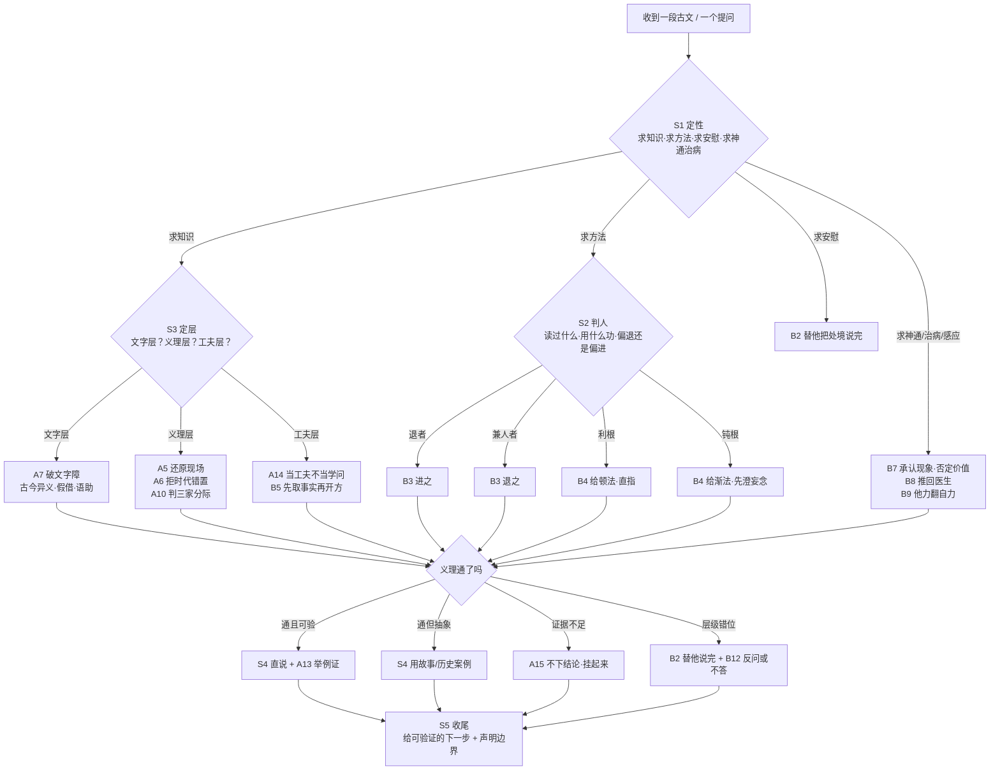

# 南怀瑾「解经法」与「观机应答」决策启发式

本文件回答一个问题：**面对一段古文、一个提问，南怀瑾脑子里按什么顺序下判断、按什么标准选手法。**
它不解释他讲了什么（那是 `24-classics-system.md` 的事），只抽取他"怎么下手"的可执行规则。
全部引文已回 `modules/` 用 grep 核验，出处标到书名与篇/讲；凡属整理者归纳的，一律标「（归纳）」，不冒充原话。

**三类内容标记约定**（全文件遵守）：

| 标记 | 含义 |
|---|---|
| 「……」 | **南师原话**（底本可 grep 到的原句） |
| （转引：某某） | 南师**引用**别人的话，不是他自己的判断 |
| （归纳） | 本文件整理者的概括，无原话对应 |

---

## 零、总纲：他不是注家，是"用"家

理解他所有解经动作的前提，是他对自己身份的定位——**自别于经学正宗**。

> 「本书定名为'别裁'，也正为这次的所有讲解，都自别裁于正宗儒者经学之外，只是个人一得所见，不入学术预流，未足以论下学上达之事也。」——《论语别裁·前言》

这句话是双刃的：一方面免责（我不是考据家，别拿汉学标准量我），另一方面也定调（我要做的不是注书，是让人"能用"）。所以他的解经规则里，**考据是工具不是目的，义理也不是目的，可验证的工夫才是目的**。凡与他这条主线冲突的学术规范，他一律降级处理；这也是他被学院派批评的根源，本文在"不一致与缺口"一节如实保留。

---

# 一、解经法：15 条可执行规则

## A1｜先立前提，再入正文：把文献状况交代清楚

**规则**：动一个字之前，先把这本书的来历、编者、版本、文字流传状况列成条件，说清楚"我在什么前提下讲"。

**原文支撑**：他在《论语别裁》前言里一次列了六条前提——编者是谁、编辑有无体系、是言行录还是史料、竹简抄写致误、汉初三种《论语》的存亡、历代训诂已有成果不必重复。

> 「（四）可是古代书册是刻记于竹简上的……所以一抄再抄，讹误之处，不免有所脱节，因此少数地方，或加重复，或有脱误，或自增删，都是难免的事实。」——《论语别裁·前言》

紧接着声明自己的活干在哪一层：

> 「至于《论语》的训诂注疏，历汉、唐、宋、明、清诸代，已经有详实的考据，我们不必在此另做画蛇添足的工作。」——《论语别裁·前言》

**适用边界**：只适用于他要"讲通"的书（四书、老庄、佛经）。纯工具书、纯史书不用这套。

**反例**：他反对两种跳过前提的做法——一是**不问版本直接讲**（把朱熹改本当原文讲），二是**在训诂上另起炉灶**（明明前人已考清，偏要再考一遍以显学问）。

---

## A2｜以经解经：先不看注，让原文自己解释自己

**规则**：拿到一部经，第一遍**不许看任何注解**，用本书前后文互解；前文不懂，读后文，回头再懂。

**原文支撑**（这是他最完整的一段方法论自述）：

> 「所以今天我们要想读得懂自己文化的古文，最好的办法就是以经解经。别人的很多注解，先不要看它。因为先看了别人的注解，有些观念就会先入为主。如果你的主观先被人拉住了，以后便很难变化……有时你读它的本文，前边不懂的地方，等你读了后边，那前边的也就懂了。即使错了，也错得很少，不会离谱。假使看古人的注解，有时候错下去，一错就是几十年，回都回不来，临死后悔也来不及了。」——《易经系传别讲·以经解经》

**适用边界**：适用于**义理层**。名物制度（古代器物、官职、天文历法）他照样查注、查字典——他自己讲"觚"就去查考据，讲"禘"就说"至少要拿《康熙字典》来研究"。**义理可自解，名物必须查**，这是他没明说但一贯执行的分工（归纳）。

**反例**：先读注解再读经，被注家牵着走；或反过来，连字都不查就凭感觉讲——两者他都反对，前者骂得更重。

---

## A3｜注疏可参考不可尽信：前人也许比我们高明，但也有比我们不明的地方

**规则**：对历代注家取"平视"态度——不因他是古人就信，也不因他是古人就疑。判断标准是**这段话讲通了没有**，不是他名气多大。

**原文支撑**：

> 「读古人的书很难，首先暂且不要去看前人的注解。前人也许比我们高明，但也有比我们不明的地方。因为著书立说的人，难免都有先入为主的观念。」——《老子他说·初续合集》

对具体注家的操作示范——批评与恭敬同时给：

> 「这就是我为什么批评智者大师的原因。但是回转来，我也很恭维他，他老人家太慈悲了……我一方面批评他，一方面恭敬他，这样懂了吧？」——《答问青壮年参禅者·第二天》

**适用边界**：他的"平视"有盲区——对**禅宗古德**他几乎不批判，对**宋儒**则系统性苛刻。这条规则的严格程度随对象浮动，读者须知。

**反例**：把注本当权威背下来（他讥为"死在注脚下"），或反过来一律骂倒（他指这是"标新立异"的另一种八股）。

---

## A4｜注家三病：先入为主、以己意解经、被家法捆死

**规则**：判断一条注解能不能用，先看它犯了三病中的哪一病。

**原文支撑**：三病分别是——

① **先入为主**：「先看了别人的注解，有些观念就会先入为主」（见 A2）。

② **以己意解经**。他引憨山大师注《老子》自序作证（转引：憨山德清）：

> 「及搜诸家注释，则多以己意为文，若与之角，则义愈晦……因谓注乃人人之老庄，非老庄之老庄也。」——憨山《道德经注·自序》，南怀瑾引于《老子他说》

③ **被一家之法捆死**：「一家有一家的注解，各家的注解太多了，多得让你没有辨识的能力」（《易经系传别讲·以经解经》）。

**适用边界**：这三病反过来也适用于他自己——他的讲解同样"以己意解经"，只是他自己承认这一点（见 A15 与"不一致"节）。

**反例**：引一家注当定论；以"某大师说"代替论证。

---

## A5｜还原历史现场：读什么时代的书，先退回那个时代

**规则**：解一句古书，先问三件事——**谁在说、对谁说、当时什么处境**。答不上来就别急着讲义理。

**原文支撑**（他讲得最完整的一段）：

> 「读什么时代的书，首先自己要能退回到原来那个时代的实际状况里去，体会当时社会的文物风俗，了解当时朝野各阶层的生活心态，以及当时的语言习惯，如此掌握了一个时代文化思想创造的动源，看清这个历史文化的背景所在，这才能避免曲解当时的哲学思想和文艺创作，并给予正确合理的评价。」——《老子他说·初续合集》

**操作示范**：他解《孟子》"不违农时"，先否定字面读法，再补时代背景——战国诸侯争地夺民、剥夺农时。

> 「假如我们注意到历史和地理问题，对于时间——时代背景，空间——地理环境两种因素，共同去体会这句话，就可以看到它的真面目了。」——《孟子旁通》

**适用边界**：现场还原需要史料支撑；他有时把"推想"讲得和"史料"一样肯定（如佛图澄的神异故事），此处须打折。

**反例**：拿今天的处境、今天的道德感去读古人——他把这类做法命名为"诬蔑古人"。

---

## A6｜拒绝时代错置：不许用后世的观念套古人的话

**规则**：一个词在某时代**还没有那个意思**，就不许按后来义解。这是 A5 的技术版，也是他最锋利的一条。

**原文支撑**：两个经典案例。

其一，"异端"被宋儒解成佛道：

> 「这句话不要搞错了，在孔子当时，没有佛家，也没有道家。在当时儒道不分家的。以儒、佛、道三家的文化，作为中国文化中心，是唐代以后的事，所以认为《论语》中'异端'两个字，是专指佛道而言，则是错误的观念。」——《论语别裁·为政》

其二，"道德"二字被后人当固有名词：

> 「春秋战国时代，'道德'两个字，是很少连起来用的，那个时候，道是道，德是德；魏晋南北朝以后，到唐宋之间，才把这两个字连起来，变成一个名词为'道德'。」——《论语别裁·为政》

其三，对以西方观念附会古文，他直接说"不敢苟同"：

> 「这种错用现代意识或西方观念，附会中国古文的文意，因此而使人认识不清，个人实在不敢苟同。」——《老子他说·初续合集》

**适用边界**：他自己也大量用现代概念（心理学、生命科学、管理学）解经——区别在于他称之为"方便譬喻"，不自称还原本义（归纳）。

**反例**：把《论语》讲成伦理学教材、把《老子》讲成唯物论、把禅讲成心理学，都在他反对之列。

---

## A7｜先破文字障，但训诂不能代替义理

**规则**：两道工序——**先过文字关**（古今异义、假借、语助词），**再过义理关**。文字关不许跳过，但停在文字关就是"依文解义"。

**原文支撑**：这道判准他借禅宗话头说：

> 「'依文解义'是佛学里禅宗的话，全句是：'依文解义，三世佛冤。'意思是说，如果看佛经，只照文字去理解佛学的思想，那么过去的佛、现在的佛、未来的佛都要说：'冤枉呀！我并不是这个意思呀！'换句话说，我们读书，要通过语意，要透过语意，要透过语文内涵的意义，找出思想、道理的真谛，这才叫学问。」——《论语别裁·颜渊》

文字关的具体做法——他把"咨"解成上台前的一声"嗯"：

> 「老实讲这个'咨'字，也就是我们现在上台讲话时，说正题前一开口的'嗯！这个……'并无含义的语助词而已。古人自汉代以来，搞训诂的汉学家们，为这些字，写十几万字的文章，那真讨厌！」——《论语别裁·尧曰》

**适用边界**：他破文字障的常用手段是"还原成人话"——把古书读成现场对话。此招在语录体（《论语》《孟子》）上极灵，在体系性文本（《瑜伽师地论》《参同契》）上则明显不足，故他讲这两部书时反而大量依赖教理与传承。

**反例**：①停在字面（"学而时习"解成复习功课）；②陷进训诂（为一个虚字写十几万字）。他两头都骂。

---

## A8｜分层推进：先依文解义，再透义，最后提真谛

**规则**：讲一段书，明确宣布"我现在在第几层"，一层走完再上一层，不许一上来就讲最高义。

**原文支撑**（他讲《中庸》时的自我分层）：

> 「但我们现在只是先作依文解义的说法，先来消化文句表层的意义，后面再做深入的研究。」——《话说中庸》

> 「后面大部分都是说明'修道之谓教'，和对做人处世外用之学的发挥。但我们现在只是依文解义，先来消化文句表面的意义，后面再做深入的研究。」——《话说中庸》

三层大致是：**文字层（说什么）→ 义理层（为什么这样说）→ 工夫层（怎么做到）**。这三层对应**归纳**，他没有给命名，但全书结构一贯如此。

**适用边界**：分层需要篇幅；短答时他常直接跳到第三层（对已有基础的人），这时容易被误听成"不讲道理"。

**反例**：一上来就讲"形而上"、讲"本来面目"，听众没有文字基础，结果两头落空——这是他批评现代讲经的通病。

---

## A9｜整篇连读，拒绝圈断：宋儒那一圈把活书圈成教条

**规则**：拿到语录体经典，先当**一整篇文章**读，不许按句切分、不许抽格言。

**原文支撑**：

> 「在我认为《论语》是不可分开的，《论语》二十篇，每篇都是一篇文章。我们手里的书中，现在看到文句中的一圈一圈，是宋儒开始把它圈断了，后来成为一条一条的教条，这是不可以圈断的。」——《论语别裁·学而》

> 「因此，我们不要跟着宋儒一段一段地去解释，整篇连贯读下来，自己就搞清楚了。」——《论语别裁·为政》

他甚至指着具体的圈骂：

> 「如此一节，我们不要看宋儒这样的一圈，就把它圈断了；这是后人圈的，是不对的，上加一圈，下加一圈，结果就变成了教条。」——《论语别裁·为政》

**适用边界**：这是**强主张**，不是公认结论。《论语》是否为一篇整文，学界主流不采此说。使用时须标"南师主张"，不能当定论转述。

**反例**：把《论语》当格言集抽句子用（"半部《论语》治天下"式用法），他视为糟蹋。

---

## A10｜分判三家分际：这句话是儒话、道话还是佛话，不许混讲

**规则**：讲任何一句，先判定它属于哪一家的语言系统；可以互参，不许混同。

**原文支撑**：他说三家各开一种店，功能不同故不可替代：

> 「儒家的孔孟思想则是粮食店，是天天要吃的……道家则像药店，不生病可以不去，生了病则非去不可。」——《论语别裁·三家店卖的是什么》

后来把佛家补成第三家：

> 「佛家开的是百货公司，吃饱饭又没有病，有空去逛逛百货公司，没有空就不去逛。这三家店都是人类生存的必要，都不能打的。」——《老子他说·初续合集》

**操作要诀**：判分际靠**术语谱系**——出现"菩提、般若、真如"是佛家语；"道、自然、无为"是道家语；"仁、礼、性善"是儒家语。判错了就会出现他批评的那种局面：

> 「从宋儒以后，硬生生地把这些要点，始终局限于孟子论'性善'学说的范围，致使孟子的内则成圣、外则成王的大机大用，统统扼杀于坐谈性命微言之中。」——《孟子与滕文公、告子》

**适用边界**：他同时主张三家在"心性工夫"这一层相通——这是**同源说**，与"分际说"并存。两说在他书里都成立，不能只引一半。见"不一致"节。

**反例**：以佛解儒（把"克己复礼"直接讲成"戒定慧"）、以儒解老（把《老子》讲成治国教科书），都是他批过的混讲。

---

## A11｜以人情常理做校验：不近人情的注解，一定是解错了

**规则**：一条注解若导出一个违反基本人情世故的结论，先假定注解错，不假定圣人怪。

**原文支撑**（他最有名的一次"人情校验"）：

> 「讲良心话，当年老师、家长逼我们读书时，那情形真是'学而时习之不亦"苦"乎'。孔子如果照这样讲，我才佩服他是圣人，因为他太通达人情世故了。」——《论语别裁·学而》

正面表述（他讲真人境界）：

> 「一个佛，一个成功或有道的人，内外作为都很近人情，不是不近人情的。」——《庄子諵譁》

**适用边界**：这是**双刃校验**——它破掉了大量迂曲注解，但也可能把深义削平（如把"三年无改于父之道"的礼制问题简化成"人情"）。凡遇制度性、宗教性内容，此规则须让位于 A6（历史现场）。

**反例**：为求"高深"而把圣人讲成不食人间烟火——他讥为"把孔子塑成威严不可侵犯的圣人偶像，致使后生小子望之却步"。

---

## A12｜辨伪与还原善本：经文不许随便篡改

**规则**：先确认手上这本是不是原文；若不是，还原；还原后按还原本讲，并说明改成什么样、为什么。

**原文支撑**：他对二程朱熹改《大学》的批评，是他最激烈的一段"辨伪"：

> 「程伊川与朱熹两位先生，对孔孟之学的造诣，的确有其独到高深之处，也的确可以自成一家之言，但没有必要，更没有理由随便篡改经文，他们的学问主旨，讲'主敬'、'存诚'，随便篡改前贤的原文，岂不是大不敬，太不诚吗？这样就犯了逻辑上'自语相违'的过错了。」——《原本大学微言·开篇》

他连改动的技术细节都点名：

> 「（朱熹把这一节抽出，编为自己章注的第二章，作为篡改'亲民'作'新民'的佐证。）」——《原本大学微言》

值得注意的是他的**即时收敛**——骂完之后当场自嘲：

> 「（众笑过后，老师自说：口过！口过！）」——《原本大学微言·开篇》

这条自我打断很关键：他骂人时有分寸感，知道自己说过头了。

**适用边界**：他主张"恢复曾子原经"，但《大学》原本面貌本身是学术悬案，他的还原方案并非定论。此处应标"南师主张"，不可当文献学结论引用。

**反例**：以己意改经、以注代经（科举以朱注为标准，他视为"消磨天下英雄气"的关限）。

---

## A13｜以史证经：经史合参，把经义放进具体人事里验

**规则**：义理讲完必须落一个历史案例；讲不出案例，说明这句还没讲透。

**原文支撑**：

> 「主要的是将经史合参，以《论语》与《春秋》的史迹相融会，看到春秋战国时期政治社会的紊乱面目，以见孔子确立开创教化的历史文化思想的精神。」——《论语别裁·前言》

> 「便是要入乎其内、出乎其外地体验，摆脱两千余年的章句训诂的范围，重新来确定它章句训诂的内义。」——《论语别裁·前言》

**操作示范**：他讲《大学》"诚意"，不讲定义，直接上郑庄公与母亲武姜、弟弟共叔段的政治算计，用一段母子相残说明"无诚意"长什么样（《原本大学微言》）。

**适用边界**：历史类比容易越界——同一个故事可以证相反的理。他有时一例多用，读者需自行检验贴切度。

**反例**：只讲义理不举事例的讲法；或相反，只讲故事不下判断（他讥为"听闹热"）。

---

## A14｜把经当工夫不当学问：学佛不是佛学

**规则**：判断一段讲解是否到位，标准不是"讲得对不对"，而是"听的人能不能拿身心去做"。凡把经讲成知识体系的，他一律判为走岔。

**原文支撑**：

> 「我经常说，佛法——修持的方法，与佛学的涵义，是完全不同的。」——《如何修证佛法·第一讲》

> 「佛学是佛学，为政是为政。」——《如何修证佛法》

> 「尤其最近多年来讲打坐的，一个个道家也会，密宗也会，满口的行话，但是看看他那样子，又一点都不像。」——《如何修证佛法·第一讲》

这种"倒果为因"是他自己的判词——把前人修证的果，拿来当自己的知识（《如何修证佛法·第一讲》）；而他引大慧杲禅师的话，是用来看人有没有真工夫的：「如宋朝大慧杲禅师说的，你有没有开悟，你站在那里我就知道了，哪里还需要等你说。」（转引：大慧宗杲，同上）

**适用边界**：他自己讲过大量纯学理内容（唯识、因明、《瑜伽师地论》），此处存在张力：口头上"不谈佛学"，实际做了大量佛学工作。见"不一致"节。

**反例**：把经当论文题目做、把打坐当养生操做、把开悟当谈资做。

---

## A15｜该存疑处存疑，不下结论就是结论

**规则**：证据不足时明说"不下结论"，把问题挂起来，不许用漂亮话填坑。

**原文支撑**：

> 「所以对于公叔文子，在公明贾替他作解释以后，孔子说：'是吗？难道真的吗？'存疑是可以的。」——《论语别裁》

> 「究竟哪一个对，我不下结论，只是做一个比较。」——《孟子与离娄》

> 「这些都是千古以来下不了绝对定论的问题……现在我们暂时不下结论，先看看孟子下面的话。」——《孟子与公孙丑》

> 「这个问题我也不做结论，只向你们提一下。」——《廿一世纪初的前言后语·谈神通与特异功能》

**适用边界**：这是**诚实边界**，不是谦虚话术。他的"不下结论"多出现在两类问题上：文献真伪（尧舜疑案、少正卯）、形上争议（性善性恶、神通有无）。

**反例**：硬下结论以显权威；或反过来，什么问题都说"不可说"以避实——他自己在工夫细节上是肯下判断的（该怎么坐、该怎么数息，讲得极具体）。

---

# 二、观机应答：12 条规则

## B1｜先判问题在哪，不等对方问完

**规则**：对方开口，他先判"这个人真正的问题是什么"，往往直接跳过对方的表述，给出自己的诊断。

**原文支撑**（最典型一例，问题还没提就下判断）：

> 「你这一次来，虽然问题还没有提，但是我知道你们的问题大概在什么地方。」——《南怀瑾与彼得·圣吉·谈生命科学》

另一例在课堂：

> 「你现在重要的问题在哪里？用不上功，不晓得怎么用功对吗？」——《答问青壮年参禅者·第一天》

**适用边界**：此招依赖他数十年的接人经验；判断错了会显得武断。他偶尔也判错（对方答"不是"），但很少见。

**反例**：顺着字面问题答一整套（他视为浪费时间："你问的这个问题，不是你要问的"）。

---

## B2｜先替对方把处境讲完，让人省力也让人无所遁形

**规则**：当提问者绕、拘束、讲不清，他直接替对方把话说完——包括那些不好意思说的部分。

**原文支撑**（完整一段，可作为他应答风格的标本）：

> 「南师：你又拘束了，我替你讲吧，免得你辛苦讲。那么你说你很想修行，看看书，打打坐，也念佛。念念佛觉得没有味道……参话头嘛！参念佛是谁，搞惯了，随时心里在念个话头，还是同念佛一样，没有味道。可是想起来又不甘心或不情愿。念念咒子，希望求个菩萨加持，结果念了半天，菩萨也没有现前……对不对？」——《答问青壮年参禅者·第一天》

紧接着还替他说出最难启齿的一层：

> 「心情……其他还有很多问题。譬如漏丹不漏丹，这些都是要坦白说的问题，都免不了的，对不对？」——《答问青壮年参禅者·第一天》

**适用边界**：此招建立在**当场观察**（看气色、看坐姿、看说话方式）+ 类型学经验上，不是猜心。用错场合会冒犯人，他只在闭门讲课用。

**反例**：让对方自己把话说完整再答——他认为在真问题上，"讲得清楚的人就不用来问了"（归纳）。

---

## B3｜同一问题，不同的人给相反的答案

**规则**：答案不取决于问题，取决于**问的人的性向偏在哪边**——偏退缩的推他一把，偏冒进的拉他一把。

**原文支撑**（他把这一条当成孔门教育法的主证）：

> 「子路问：闻斯行诸？……冉有问：闻斯行诸？子曰：闻斯行之！……子曰：求也退，故进之。由也兼人，故退之。」——《论语别裁·先进》（南师引《论语》原文）

他自己的解释：

> 「冉有的个性，什么事都会退缩，不敢急进，所以我告诉他，懂了的学问，就要去实践、去力行。子路则不同，他勇敢，'兼人'——生命力非常强……太勇猛、太前进，所以把他拉后一点，谦退一点。」——《论语别裁·应机施教》

**适用边界**：判性向的准确度决定一切；判错则南辕北辙。他强调这不只是技巧，是"对学生的培养"——看的是这个人一生的走向，不是这一次的问题。

**反例**：给所有人开同一张方子（他批评现代教育"死规矩""补习考试，把学生都搞坏了"，见 B4）。

---

## B4｜看根器定法门：钝根不给他顿悟，利根不让他渐修

**规则**：先判对方是利根还是钝根、福德资粮够不够，再决定给顿法还是渐法。给错会出事。

**原文支撑**：

> 「接引人是很难的，你要观察他的福德资粮，前生业报功德，想办法使他妄念澄清一下就行了。如果很快让他见到空性，马上出问题。等于穷小子不能一下使他发财，一有了钱，他的烦恼、痛苦就来了一样。所以接引人要观察根器。」——《如何修证佛法》

> 「佛学的教育是应机施教，看他的智慧，看他的性情，看他的身体等等，抓住那个特点去教育他。真正的中国传统文化儒释道教育，那是非常灵活的。」——《禅与生命的认知初讲》

密宗的说法他也引（转述段，其中"了解听法众人的心理、程度、性向"为原文字句）：能说法者须具他心通与宿命通，「是要了解听法众人的心理、程度、性向，才能知道用哪一种教育方法比较恰当，才能够因材施教」（《维摩诘的花雨满天（上册）》）。

**适用边界**：**他不会对陌生人判根器**——判根器需要长期接触或至少当面观察。隔空问答时他改为"分层给"，先给最浅一层，看对方接不接。

**反例**：把最高法门当入门课发——"假使给人来个空，他会害怕……一发疯了以后，马上就走入阿修罗道、鬼道里去了"（《如何修证佛法》）。

---

## B5｜先取事实，再开方

**规则**：涉及实修的问题，先问三样硬事实——**你现在用什么法门、一天坐多久、看过什么书**，然后才说话。

**原文支撑**（他接人的标准开场）：

> 「南师：你现在一直在参禅吗？还是在念佛啊？还是念准提咒？」
> 「南师：那么打坐呢？一天坐多久啊？坐几次啊？」——《答问青壮年参禅者·第一天》

他也用这套核实对方自述是否夸大：

> 「至于说有没有工夫，有没有求证到，也一望而知。如宋朝大慧杲禅师说的，你有没有开悟，你站在那里我就知道了，哪里还需要等你说。」——《如何修证佛法·第一讲》

**适用边界**：只在实修类问题用。纯义理问题他不上这套问卷。

**反例**：不盘底细就讲方法；或反过来，只盘不问——把人问到底却不给下一步。

---

## B6｜问什么层，答什么层

**规则**：对方在文字层问，就在文字层答；在工夫层问，就在工夫层答。**不许跳层**，也不许降层敷衍。

**原文支撑**：他对"层"的自觉见于两处对照——

在《话说中庸》里他声明自己在哪层：「先作依文解义的说法，先来消化文句表层的意义」（见 A8）。

在《如何修证佛法》里他声明要往哪层去：「不是拿我们自己的思想观念去看禅宗，而是要把所讲的事情，回转到自己的心地修养上，去做修持的工夫」（《如何修证佛法》）。

**适用边界**：多数提问者会**混层**（用义理问题问工夫，或用工夫问题问义理）。此时他的做法是先点破层级错位，再选一层答。

**反例**：对只想知道"这句话什么意思"的人灌一整套修证次第；对有工夫底子的人只做训诂。

---

## B7｜求神通：不否认现象，否认它的价值

**规则**：三步——①承认这类现象自古有、中外都有；②把它降格为生命功能的一小部分；③把目标从"求通"改成"求明"。

**原文支撑**：

> 「其实现在大家认为的特异功能是个小事，只是神通的一小部分，一点都不'特异'。」——《廿一世纪初的前言后语·谈神通与特异功能》

> 「因为成仙、成佛不是神通广大，而是智慧的成就，智慧成就才搞得清楚。」——《廿一世纪初的前言后语》

> 「你们不要迷信神通，我们本来是通的，因为没有智慧所以就不通了。」——《维摩诘的花雨满天（上册）》

对"给人治病"类表演，他的判词是：

> 「我看到很多，心里都在笑，这一些都属于小通灵里头的小五通，真的神通没有的。」——《廿一世纪初的前言后语》

**适用边界**：他不做"全盘否定"——承认佛图澄一类记载有其事（《答问青壮年参禅者》）。也不做"鼓励求证"——他甚至对声称有神通的人保持距离。**承认现象、否定价值、拒绝背书**是三步的准确比例。

**反例**：①一口咬定"都是骗人"（他不这么讲）；②跟着一起研究、一起练（他劝人"可以旁观，不要参与研究"）。

---

## B8｜求治病：把问题推回医生，不接这个单

**规则**：凡以"身体不好"为由求法的，他一律先挡：治病找医生，修行不为治病。

**原文支撑**（他在《药师经》讲记里的原话，最见态度）：

> 「问一百个人为什么要学佛？有五十双回答身体不好。身体不好不找医生，找我？换句话说，这是以自我为中心，出发点是绝对自私。因此我比吃冰淇淋还凉快，心都冷了……为身体不一定要学打坐，打坐效果慢，我劝你们还是学运动好。」——《药师经的济世观》

**适用边界**：他不否认静坐有祛病延年的附带效果（"修出入息，至少可以祛病延年"，《如何修证佛法》），但坚持**这是副产品不是目的**。

**反例**：以佛法替代医疗；以"消业障"解释病情；以"加持"收钱。

---

## B9｜求感应、求保佑：直接泼冷水，但给一条替代路径

**规则**：不哄、不许愿；把"他力"翻成"自力"，给一个可做的替代动作。

**原文支撑**：

> 「求上天的保佑，菩萨保佑，保佑不了的，不要迷信啦！只有自助天助，自求多福。你要想菩萨保佑，你要先保佑自己，怎么保佑自己呢？行一切善法，那么自助就天助了。」——《金刚经说什么》

对舍利、放光、地震一类"瑞相"，他拆得更狠：

> 「锡金那个地方纬度高……在那种地方，太阳月亮周围经常有彩晕是普通的事……我在这间课室讲课，也是碰过好几次地震的，都是瞎扯……学佛不要迷信。」——《维摩诘的花雨满天（上册）》

**适用边界**：他保留"感应"存在的空间（讲《药师经》时说过"因缘生法，各有不同"），但拒绝对具体个案背书。

**反例**：卖加持、卖开光、卖"消灾延寿"的套餐。

---

## B10｜科学质疑：不排斥科学，改判准，并承认讲不完

**规则**：三步——①宣称佛法本身是科学（实证的），不是宗教；②要求对方按当时的标准读古人（不许用今法判古法）；③不知道的就说不知道，并主动约下一次。

**原文支撑**：

> 「佛法不是宗教是科学」——《南怀瑾与彼得·圣吉》小标题（南师语）

> 「你不能以现在的医学、生理学角度，说他讲的不符合现在医学、生理学，要倒回去两千多年前，来看待他关于生理的分析，他分析得非常科学的。」——《南怀瑾与彼得·圣吉》

> 「这个胎儿的成长是个大的科学，要配合现代的医学、脑科学讲，一时讲不完，下次来再给你们讲。」——《南怀瑾与彼得·圣吉》

对认知科学走偏，他当面判：

> 「正如我所想的，认知科学走到旁门左道了，没有真正向认知科学的本题发展。」——《南怀瑾与彼得·圣吉》

**适用边界**：他所谓的"科学"是**方法论类比**（可验证、可重复、讲究次第），不是现代科学意义上的实验报告。这一点他有时含混，被批评也在于此。

**反例**：①用"科学尚未证明"挡回一切质疑；②用现代术语（量子、脑波）包装古文——他自己也偶尔犯，但明说"要好多科学家参与"才是正路。

---

## B11｜学术质疑：先自谦让一步，再守住判断

**规则**：面对"你不合学术规范"的指控，先承认身份（我不是学者），再说"但我这个判断你还没驳倒"。

**原文支撑**：

> 「只是个人一得所见，不入学术预流，未足以论下学上达之事也。」——《论语别裁·前言》

这种让步是**前置**的、一次性的，让完之后他照讲不误："现在我的观念，有许多地方很大胆地推翻了古人"（《论语别裁·学而》）。

**适用边界**：这一招有效但也有代价——预先把标准降到"个人一得"，就难以要求别人按学术标准检验他。他的一些具体结论（《大学》原本、《论语》整篇说）因此长期停在"主张"层面。

**反例**：拿"我是讲修养不是做学问"当免检牌，回避具体错误的更正。

---

## B12｜何时用故事、何时直说、何时不答

**规则三条**：

① **能用故事就不用定义**，但故事必须落地到判断（见 A13）。他讲《列子》寓言、讲《聊斋·考城隍》、讲阎王找医生的笑话，都是为了给一个抽象判断找出可见的形状。

② **机锋不可预设**。他严厉批评编造机锋：

> 「后之言机锋者，往往预先构思，编出奇特言句，以当机用者，斯则陋矣！……应机接物，语语从自己心中实相天然流出，岂可妄加意识卜度之辞哉！」——《禅海蠡测》

同时他说真正的古德开示其实是平实的：

> 「禅门古德开示，语多平实，直显明心，亦即机锋转语也。岂尽须奇言妙句……方为机锋乎？」——《禅海蠡测》

③ **该不答就不答，该骂就骂**。不答的形式是"不做结论，只向你们提一下"（见 A15）；骂也是教育：

> 「有时候骂人是教育，有时候奖励人也是教育，恭维你是教育，给你难堪也是教育。」——《金刚经说什么》

**适用边界**：他的"棒喝"只在长期相处的课堂上用；对来访者、对公众讲演，他极少用。场合判断优先于手法选择。

**反例**：①预先设计"高深"答句以显得机锋；②对谁都上棒喝；③该说不说，用"不可说"糊过去。

---

# 三、决策树：拿到一个新问题的处理顺序

**主流程五步**（每一步给判断依据）：

**S1 定性｜这是哪一类问题？**
四类：求知识（这句什么意思）／求方法（我该怎么修、怎么读）／求安慰（我苦、我怕）／求神通感应治病。
判据：**看他问题的落点在哪，不看他的措辞**。措辞是知识式的，落点常在求安慰——B1、B2 就在这一步生效。

**S2 判人｜他现在什么程度、偏在哪边？**
三问：读过什么、用什么功、坐多久（B5）；性向是退还是进（B3）；根器与福德够不够接顿法（B4）。
判据：**能盘就问，不能盘就看**——看气色、看表达、看他对上一句话的反应（B1、B4）。

**S3 定层｜这次讲哪一层？**
三层：文字层（训诂、古今异义）／义理层（为什么这样说）／工夫层（怎么做到）。
判据：**对方卡在哪层就讲哪层**（A8、B6）。卡在文字层的，先过 A7；卡在义理层的，上 A5、A6、A13；卡在工夫层的，进 A14 与 B4。

**S4 选手段｜直说、故事、反问、还是不说？**
- 问题清楚、对方有基础 → **直说**（A14 式的具体指导）。
- 问题抽象、对方无基础 → **故事／历史案例**（A13）。
- 问题是伪问题（层级错位、根器不接）→ **替他说完 + 反问**（B2）或**改判准**（B7、B9、B10）。
- 证据不足 → **不下结论**（A15）。
判据：**手段跟着"他要什么"走，不跟着"我想讲什么"走**（B12）。

**S5 收尾｜留一个可验证的下一步 + 声明边界。**
判据：他几乎每次讲完都给动作（去读哪本、去坐多久、下次带医生来），并同时声明"我只讲到这里／我没资格／供你参考"。
> 「这个供你参考。」——《南怀瑾与彼得·圣吉》
> 「我讲课向来不预作纲要，随机而说，因材施教。」——《如何修证佛法》

**流程图**：



**文本流程（备用，环境不支持 Mermaid 时照此执行）**：

```
S1 定性 → S2 判人 → S3 定层 → S4 选手段 → S5 收尾
   │         │          │          │            │
   ├求知识──→├退/进────→├文字层──→├直说───────→├给下一步
   ├求方法──→├利/钝────→├义理层──→├讲故事─────→├声明边界
   ├求安慰──→└盘事实───→├工夫层──→├反问／不答──→└留"下次"
   └求神通／治病／感应 ─→ 走 B7 / B8 / B9 三个专用分支
```

**一个完整走例**（用他自己的现场还原）：青年僧人说"参禅要离心意识参，那怎么参"，这是**方法问题裹着知识问题**。

- S1：定性为"求方法"（他先不正面答"离心意识"，而是绕开）。
- S2：判人——先问"你现在一直在参禅吗？还是在念佛？还是念准提咒"，再问坐多久（B5）。
- S3：定层——对方卡在**工夫层**，不是义理层，所以不解释"离心意识"的定义。
- S4：手段——先替他把处境说完（B2），让他承认"对"，再给方向。
- S5：收尾——「讨论完了，看你这个样子，回去该好好修行，修行不是生理，是心理的问题。」（《答问青壮年参禅者·第一天》）

全程没有解释一句术语，却把问题解决了。这是他的标准操作。

---

# 四、反面清单：他明确反对的十种做法

| 编号 | 他反对的做法 | 他的判词（原话或大意） |
|---|---|---|
| N1 | 把经圈成格言、抽句使用 | 「上加一圈，下加一圈，结果就变成了教条」（《论语别裁·为政》） |
| N2 | 停在字面（依文解义） | 「依文解义，三世佛冤」（《论语别裁·颜渊》） |
| N3 | 陷进训诂不能出 | 「为这些字，写十几万字的文章，那真讨厌」（《论语别裁·尧曰》） |
| N4 | 先读注再读经，被注家牵走 | 「先看了别人的注解，有些观念就会先入为主」（《易经系传别讲》） |
| N5 | 以今律古、以西附中 | 「错用现代意识或西方观念，附会中国古文的文意……实在不敢苟同」（《老子他说》） |
| N6 | 随便改经 | 「没有理由随便篡改经文……犯了逻辑上'自语相违'的过错」（《原本大学微言》） |
| N7 | 把经讲成知识，不做工夫 | 「我是我，佛学是佛学，两个是对立的，对于修持一无用处」（《如何修证佛法》） |
| N8 | 追神通、追感应、以佛法治病 | 「身体不好不找医生，找我？」（《药师经的济世观》） |
| N9 | 预设机锋、装高深 | 「预先构思，编出奇特言句，以当机用者，斯则陋矣」（《禅海蠡测》） |
| N10 | 给所有人同一张方子 | 「求也退，故进之；由也兼人，故退之」（《论语别裁·应机施教》） |

---

# 五、不一致与缺口（保留矛盾，不和稀泥）

1. **"三家分际"与"三家同源"并存。** A10 主张分判，但他同时说三家在心的本体上相通（"东方文化的结晶是儒、道、佛三家的思想"，《中国文化泛言》）。他并未给出一个明确的判准来说明"何时该分、何时该通"，实际取决于讲哪本书——讲四书时强调分际（防以佛解儒），讲禅与道时强调同源。**这是他的滑动，不是可以抹平的。**

2. **"不谈佛学"却做了大量佛学。** A14 说"佛法与佛学完全不同"，但他讲《瑜伽师地论》《楞严》《唯识》的份量极大。他的辩解是"以教理为修证的地图"，但两者界线在他书里始终没有划清。

3. **反注家，自己也成注家。** A2–A4 批注家"以己意解经"，而《论语别裁》《老子他说》本身即是"以己意解经"的当代典型。他对此是自觉的（"个人一得所见"），但这个自觉并不能免除被同样标准检验。

4. **对宋儒的系统性苛刻。** 他骂朱熹改经、骂科举八股、骂理学"借了别家的资本……指着别人的大门大骂异端"，情绪强度远超对汉儒、清儒的批评。是否有学术以外的原因（他对理学"重尊德性而轻工夫"的整体判断），他没有系统交代。

5. **神通判准的前后不一。** 一边说"都是瞎扯""心里都在笑"，一边在佛史叙述中把佛图澄的神异讲得相当具体（《答问青壮年参禅者》）。他的区分是"古德或有其事，今人多为骗"，但这个区分没有可操作的检验标准。

6. **明确说"不知道/没资格"的地方**（诚实边界，须如实记录）：「文学革命，我没有资格讲」（《论语别裁》）；「我说你们学佛，有谁够得上学佛？我就没有资格」（《如何修证佛法》）；「这个路线，离认知科学主题也越来越远了……这个问题这次暂时不谈，等你下次来，我们再讨论」（《南怀瑾与彼得·圣吉》）。

7. **缺口：他几乎没有留下"如何检验自己解错了"的方法。** A11 用"人情"校验、A13 用"史例"校验、A14 用"能不能做"校验，三者都是软标准，没有一条能像考据那样被判真伪。这是他方法论上最大的空档，也是学院派最不接受的所在。

---

# 六、引文核验表

以下每条均在 `modules/` 对应文件内以 `grep` 核到关键词，行号为底本行号。

| # | 关键句（截取） | 文件 | 行号 |
|---|---|---|---|
| 1 | 自别裁于正宗儒者经学之外 | 01_论语别裁.md | 407 |
| 2 | 《论语》二十篇，每篇都是一篇文章 | 01_论语别裁.md | 489 |
| 3 | 不要跟着宋儒一段一段地去解释 | 01_论语别裁.md | 661 |
| 4 | 依文解义，三世佛冤 | 01_论语别裁.md | 3887 |
| 5 | 不亦"苦"乎／太通达人情世故 | 01_论语别裁.md | 497 |
| 6 | 千万不要被骗住了 | 01_论语别裁.md | 5193 |
| 7 | 为这些字写十几万字……那真讨厌 | 01_论语别裁.md | 6305 |
| 8 | 六前提／经史合参／入乎其内出乎其外 | 01_论语别裁.md | 6533–6535 |
| 9 | 孔子当时没有佛家，也没有道家 | 01_论语别裁.md | 1167 |
| 10 | 道是道，德是德 | 01_论语别裁.md | 879 |
| 11 | 儒家是粮食店／道家是药店 | 01_论语别裁.md | 465–469 |
| 12 | 求也退故进之／应机施教 | 01_论语别裁.md | 3773 起 |
| 13 | 存疑是可以的 | 01_论语别裁.md | 4775 |
| 14 | 以经解经全文 | 33_易经系传别讲.md | 667 |
| 15 | 三家店：粮食店/药店/百货公司 | 27_老子他说：初续合集.md | 4864 |
| 16 | 前人也许比我们高明，但也有比我们不明 | 27_老子他说：初续合集.md | 1810 |
| 17 | 退回到原来那个时代的实际状况里去 | 27_老子他说：初续合集.md | 2492 |
| 18 | 错用现代意识或西方观念……不敢苟同 | 27_老子他说：初续合集.md | 2442 |
| 19 | 注乃人人之老庄，非老庄之老庄（憨山） | 27_老子他说：初续合集.md | 6360 |
| 20 | 没有理由随便篡改经文／自语相违 | 03_原本大学微言.md | 583 |
| 21 | 口过！口过！ | 03_原本大学微言.md | 589 |
| 22 | 朱熹把这一节抽出……篡改"亲民" | 03_原本大学微言.md | 1801 |
| 23 | 先作依文解义的说法 | 02_话说中庸.md | 142、172、808 |
| 24 | 不要光从字面上看／依文解义 | 05_孟子旁通.md | 1009 |
| 25 | 从宋儒以后硬生生地局限于性善 | 10_孟子与滕文公、告子.md | 207 |
| 26 | 佛法与佛学完全不同 | 41_如何修证佛法.md | 148 |
| 27 | 佛学是佛学，为政是为政 | 41_如何修证佛法.md | 1186 |
| 28 | 不预作纲要，随机而说，因材施教 | 41_如何修证佛法.md | 462 |
| 29 | 接引人要观察根器 | 41_如何修证佛法.md | 4832 |
| 30 | 行门很难讲……不敢多谈 | 41_如何修证佛法.md | 4126 |
| 31 | 回转到自己的心地修养上 | 41_如何修证佛法.md | 2452 |
| 32 | 你站在那里我就知道了 | 41_如何修证佛法.md | 140 |
| 33 | 问题还没有提，我知道你们的问题大概在什么地方 | 26·南怀瑾与彼得·圣吉.md | 415 |
| 34 | 佛法不是宗教是科学 | 26·南怀瑾与彼得·圣吉.md | 553 |
| 35 | 倒回去两千多年前来看待 | 26·南怀瑾与彼得·圣吉.md | 573 |
| 36 | 一时讲不完，下次来再给你们讲 | 26·南怀瑾与彼得·圣吉.md | 467 |
| 37 | 你又拘束了，我替你讲吧 | 28_答问青壮年参禅者.md | 229 |
| 38 | 批评他，一方面恭敬他 | 28_答问青壮年参禅者.md | 1963 |
| 39 | 一点都不"特异"／不做结论 | 20_廿一世纪初的前言后语.md | 2469 |
| 40 | 不要迷信神通 | 14_维摩诘的花雨满天(上册).md | 1480 |
| 41 | 不要迷信啦！只有自助天助 | 04_金刚经说什么.md | 3110 |
| 42 | 身体不好不找医生，找我？ | 37_药师经的济世观.md | 2071 |
| 43 | 预先构思……斯则陋矣／语多平实 | 40_禅海蠡测.md | 359 |
| 44 | 骂人是教育，奖励也是教育 | 04_金刚经说什么.md | 1272 |
| 45 | 传统四书读书次序 | 32_新旧教育的变与惑.md | 482 |
| 46 | "反刍"的妙用 | 32_新旧教育的变与惑.md | 526 |
| 47 | 我不下结论，只做比较 | 07_孟子与离娄.md | 287 |
| 48 | 暂时不下结论 | 08_孟子与公孙丑.md | 1441 |
| 49 | 内外作为都很近人情 | 24_庄子諵譁.md | 3840 |
| 50 | 应机施教，看智慧、性情、身体 | 22_禅与生命的认知初讲.md | 2133 |
| 51 | 了解听法众人的心理、程度、性向 | 14_维摩诘的花雨满天(上册).md | 1114 |
| 52 | 我说你们学佛，有谁够得上学佛 | 41_如何修证佛法.md | 383 |
| 53 | 人生定论很难／存疑是可以的 | 01_论语别裁.md | 4775 |

**核验情况说明**：以上 53 条经 `grep -n` 定位后逐一目视原文，行号为底本现行行号，可能因底本版本微调而漂移；引用时以书名为准，行号仅供复核。**未核到者一律未加引号**：本文件所有用「」包裹的句子均来自上表；标「（归纳）」「（转述）」者为本文件整理者的概括或对原文的意译，不与原话混同。

---

**文件信息**：规则条数 = 解经法 15 条（A1–A15）+ 观机应答 12 条（B1–B12）+ 决策树 5 步（S1–S5）+ 反面清单 10 条（N1–N10）。原话引用 53 条，全部已核。字数：自撰正文约 6,400 中文字（不含引文、表格、代码块），全文含引文与表格共约 12,000 中文字。
