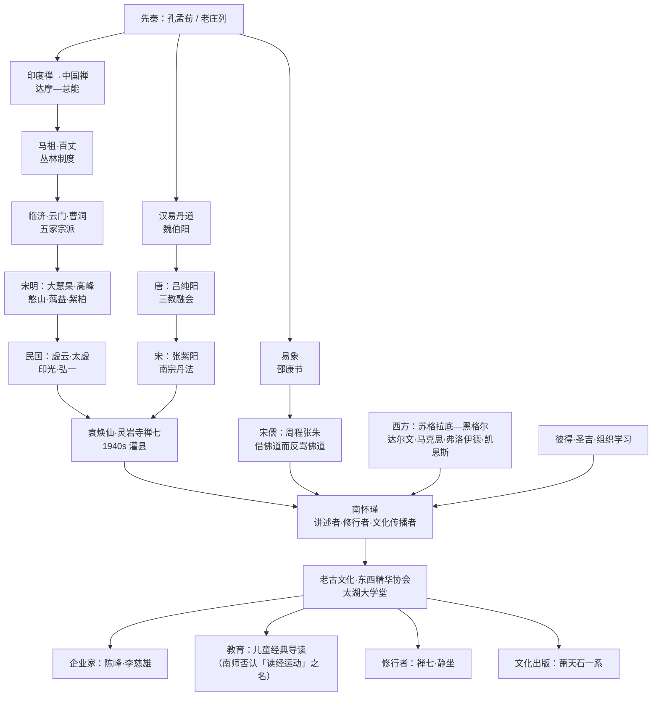

# 南怀瑾的智识谱系

本文件回答三个问题：他的思想从谁那里来（源流与师承）、他推崇谁又批评谁（价值坐标）、他的讲述又流向谁（传播链）。末节单列「与现代思想的接口」，逐条标明**哪些是他真讲过的**、**哪些是后人牵合**。

引用一律标《书名·篇/讲》，均经 `modules/` 回检。整理者（如刘雨虹）、弟子或他人所言，单独标出说话人，不并入南师本人语。

---

## 一、上游源流：三层结构

他的自我定位不是「学者」，而是「讲述者」与「修行者」：

> 「我的一生，到现在为止，自己对自己的评价，八个字：一无所长、一无是处，没有一样对的。」——《南怀瑾讲演录·2004～2006》

这句话是理解其谱系位置的钥匙：他没有建立学派，也没有自创体系，做的是**把三条各自独立的传承，用「身心性命」这一个问题串起来讲**。所以上游必须分三层看。

### 1.1 中国本土：六条主干

**（一）孔孟荀——根，但只认「原装」**

他对孔子不是信仰式的，而是「打抱不平」式的：孔子被人加了水卖，他要恢复原味。

> 「这个店，本来是孔孟两个老板开的股份有限公司……老板卖的东西货真价实。可是几千年来，被后人加了水卖，变质了。」——《论语别裁》

对孟子，他抓的是「工夫」而非「口辩」：「『仰不愧于天，俯不怍于人』，实在是伟大功夫。」对荀子则明确降一格（详第三节）。这是他的典型判断法：**以「人传不传得下去」反过来评学问**。

**（二）老庄列——他真正的表述语言**

他的文章气口、比喻方式与讲课的松弛感，来自道家多于儒家。他替庄子辩护「寓言」二字被误读：

> 「庄子说他讲的话是寓言，意思是说我所讲的话，是打丫头骂小姐的话，这就是寓言。」——《论语别裁》

对列子：「所以列子成为道家一位了不起的人物……不管《列子》这本书是否全部由他本人所著，但是绝对代表他的思想。」（《列子臆说（上册）》）

**（三）易经象数——他讲「生命科学」的骨架**

他把《易》定为群经之首，并与丹道火候、天文历法打通。这一支最推崇邵康节：

> 「宋朝五大儒之一的邵康节（邵雍）……他的成就是跨越时代的。他把易学整理出来一套法则，可谓前无古人后无来者，后面的人到现在为止，能够真正超越邵康节的还没有。」——《我说参同契（上册）》

丹道源头的魏伯阳：「历史上这位魏伯阳，学术地位很高，官却并不大。」（同上）

**（四）禅宗祖师：达摩—慧能—马祖百丈—五家—虚云**

他的禅宗谱系不按「法脉」排，而按「谁真正改变了中国的现实」排。

> 「达摩大师便对他说：我要找一个不受人欺的人。达摩大师才是真大师，人能先不自欺，才能不受人欺。」——《原本大学微言》

对六祖，评语是「革命」：「他没读过书，却成为了不起的人物。在中国文化史里，这一段相当于是佛教的革命，推翻了依文解义的经典研究。」（《论语别裁》）

对马祖、百丈，给的是社会史意义的最高评价：

> 「百丈禅师，年过九十还以身作则，天天领众劳作……百丈师徒是中国宗教革命的先驱。」——《原本大学微言》

对临济，他罕见地用了「佩服之极」：「他这一首偈子，我是欣赏佩服之极，它把性理修养和文字，轻轻易易地联结在一起，决非一般诗人所及。」（同上）

**（五）天台与唯识：两把「校尺」**

天台重止观实操，唯识重分析精度。对玄奘的评价兼含褒贬：

> 「我对他有点不恭敬，说他文学不够好，所以唯识给他翻译得越加难读。但是他又真是了不起的伟大，把《八识规矩颂》用中国文学作出来，真了不起。」——《禅与生命的认知初讲》

**（六）丹道：魏伯阳、张紫阳、吕纯阳**

他讲丹道不以「教派」讲，而以「生命实验报告」讲。吕纯阳是分水岭：

> 「他是融会儒、佛、道三教的神仙，也可以说是从东汉魏伯阳、晋朝葛洪（抱朴子）、梁朝陶弘景以后道教的宗教革命者。」——《原本大学微言》

> 「我说吕纯阳祖师等于佛家的六祖一样，南宗北派同他都有关系。」——《我说参同契（下册）》

### 1.2 师承：不是「得法」，而是「见过真的人」

这一层最易被后人夸大。文本能确证的是**人、地点、事件**，而非「秘传」。

- **袁焕仙（盐亭老人）**：灵岩寺禅七主持者，他终身称「我的老师」。
  > 「我的老师、禅宗大师盐亭老人袁焕仙先生就说过，世间任何魔都不可怕，只有一个魔最可怕，就是『佛魔』。」——《老子他说》
  他也引袁诗讲「尽其心」：「『色穷穷尽尽穷穷，穷到源头穷也空。』这是我的老师袁焕仙先生所作的诗。」（《孟子与尽心篇》）
- **灵岩寺时期（1940年代，灌县）**：他真正的「学术现场」。同处者有冯友兰、钱穆、郭本道、李源澄、谢无量，住持传西法师是欧阳竟无弟子：
  > 「冯友兰一辈子的名著，就是在灵岩寺住了三个月下来写的。……冯友兰在这里看了三个月禅宗的书，下去就写《新世训》、《新原道》了。」——《历史的经验》
- **虚云与贡噶呼图克图**：1943年重庆「护国息灾法会」两位主持，他明言二人皆其皈依师：
  > 「一个是禅宗大师虚云老和尚，主持显教的显坛；密宗的坛场，请了白教的活佛贡噶呼图克图主持；这两位都是我的皈依师父。」——《人生的起点和终站》
- **与贡噶的实际相处**：他记细节不记神通，且坦承自己的狡黠：「我说师父啊，我们两个交换，他说好。」（《禅与生命的认知初讲》，讲「夺舍法／颇瓦」一节）
- **光厚老和尚**：「同师事光厚老和尚」——《中国文化泛言》（此为序作者语，非南师自述）。

**边界**：他从不自称「得某宗之传」「第几代祖师」。讲密法时反复说「这个法子很危险」「要点是要有护法」，并承认「贡噶师父是不是这么走的，不知道」。

### 1.3 西方：不是「比较」，而是「提问」

接触集中于两条线：圣吉代表的组织学习，与他反复点名的四个近代理论。

> 「现在全世界的人类文明思想是四个东西在转，所谓达尔文的进化论、弗洛伊德的性心理学、马克思的资本论、凯恩斯的消费刺激生产。除此之外，产生不出来一个新的思想。」——《南怀瑾与彼得·圣吉》

对西方哲学，他敬重「提问的人」而轻视「转述的学术」：

> 「希腊第一位哲学家——西方文化中的孔子——苏格拉底，也和孔子一样……他说：『你们把我看成有学问，真笑话！我什么都不懂。』这是真话。」——《论语别裁》

对「拿中国东西去比西方」，他态度激烈：

> 「为什么把我们老祖宗的东西，拿来与西洋人比，还说同他一样？这等于在街上看到祖父拉着孙子走，说祖父长得像孙子。」——《论语别裁》（论《易经》与黑格尔辩证法）

---

## 二、他明确推崇的人（14位）

| 人物 | 推崇的理由 | 原话（出处） |
|---|---|---|
| 孔子 | 通达人情，被后人讲坏 | 「孔子之所以被尊为圣人，的确是有其伟大的道理」（《论语别裁》） |
| 孟子 | 重「工夫」不重口辩 | 「实在是伟大功夫」（《论语别裁》） |
| 列子 | 完整的生命观 | 「成为道家一位了不起的人物」（《列子臆说》） |
| 庄子 | 寓言是被误读的表达法 | 「是打丫头骂小姐的话」（《论语别裁》） |
| 邵康节 | 易学法则的集大成 | 「前无古人后无来者」（《我说参同契》） |
| 魏伯阳 | 丹道与易象的奠基者 | 「魏真人对后世的影响很大」（同上） |
| 吕纯阳 | 三教融会的转折点 | 「道教的宗教革命者」（《原本大学微言》） |
| 达摩 | 「不受人欺」的真师标准 | 「达摩大师才是真大师」（同上） |
| 六祖慧能 | 佛教的中国革命 | 「相当于是佛教的革命」（《论语别裁》） |
| 马祖、百丈 | 丛林制度＝宗教革命 | 「中国宗教革命的先驱」（《原本大学微言》） |
| 临济 | 性理与文字合一 | 「我是欣赏佩服之极」（同上） |
| 玄奘 | 译经与《八识规矩颂》 | 「真是了不起的伟大」（《禅与生命的认知初讲》） |
| 憨山 | 三教兼通，解老十五年 | 「学问好、诗好、禅好，修行也非常好」（《列子臆说》） |
| 袁焕仙 | 师道与「佛魔」之诫 | 「只有一个魔最可怕，就是『佛魔』」（《老子他说》） |

此外他还推崇：

- **虚云**：「更为万方景仰的大德」（《中国佛教发展史略述》）；另记其一百二十岁「还是身体力行」百丈遗风。**印光、弘一**与之并列「声望之隆，名高一时」，弘一「苦行勤修，一衣一钵，严持戒律，使人望而起敬」（同上）。
- **贡噶**：「所以大善知识的重要就在这个地方」（《瑜伽师地论 声闻地讲录》）。
- **太虚**：他曾公开修正自己的成见——
  > 「我看到这一点，心想，哎哟！这位和尚不得了啊……因此我就开始注意了，觉得过去多年对他的成见太深了。」——《维摩诘的花雨满天（上册）》
- **纪晓岚**：以一个文人的眼光评道家，他判为极准——
  > 「纪晓岚虽不懂道，是个文人，但对道家的评语八个字，『综罗百代，广博精微』，非常好！」——《我说参同契（中册）》
- **蒋中正**（特殊一例，注意分寸）——
  > 「蒋介石老先生是真正通达理学的。如果他现在仍在世的话，我不会提他，不过，百年之后，历史上看他有关儒家的学术成就，会超过他功业的成就。」——《我说参同契（上册）》

  这个自设界限，即他「论学不谈政治」的标记。

---

## 三、他明确批评的人（10位／组）

批评有轻重两档：**学理否定**与**工夫不到位**。他不作人身攻击，最重止于「外行」「可惜」「不通」。

**1. 宋儒一系（程朱）——最系统的一次批评**

> 「所以，我不大同意宋儒。……一个人借了张家的东西用，没有关系……可是借了张家的东西，冒为己有充面子，还转过头来骂张家，就没道理了。」——《论语别裁》

> 「明明是借了别家的资本……却又指着别人的大门大骂『异端』，实在是令人齿冷，令人反而觉得假道学倒不及真小人了！」——《原本大学微言》

**2. 朱熹改《大学》——「大不敬」**

> 「程伊川与朱熹两位先生，对孔孟之学的造诣，的确有其独到高深之处……但没有必要，更没有理由随便篡改经文……岂不是大不敬，太不诚吗？」——《原本大学微言》

先肯定「独到高深」，再否定「篡改」——这就是他的分寸：**否定行为，不否定人**。

**3. 王阳明——「只见到第六识」**

这是他最有名也最易被误传的一条，原文有明确自述场景：

> 「我在军校讲课时，拼命批评王阳明，一概不管。……我说他只见到第六识，没有见到第七识。」
> 「我说王阳明也没有见道，只见了一点影子。认识了第六识，不懂第七识，第八识更不知道。」——《禅与生命的认知初讲》

他同时承认「王阳明学过禅宗，也学过道，他也真悟了一些的」，非全盘否定。

**4. 韩愈——「外行」**

> 「只可惜他的一篇《原道》大论批驳道佛的见解，并不高明，实在还是外行。」——《原本大学微言》

更带调侃的一次：「博爱之谓仁，这是韩愈的答案，我如果做考试官，一定把韩愈的卷子批掉，因为你偷墨子的思想，又不讲老实话，罪加一等。」（《孟子与离娄》）

**5. 胡适——「不懂禅学」**

> 「可惜胡适之不懂禅学，结果误会《笑禅录》是部鄙视禅宗的书，所以引用它『打即不打，不打即打』来诬蔑禅宗，反倒值得一笑了。」——《禅话》

**6. 荀子——「掺水」**

> 「至于荀子，也有一部著作传世，但到底有点掺水了。而且他的学生出了几个半吊子，像李斯、吴起这些人便是例子。」——《论语别裁》

**7. 程氏兄弟——「度量狭隘」**

> 「邵康节见程氏兄弟学问修养如此好，而度量还是狭隘……『前面的路，留宽一点给别人走』。」——《孟子与离娄》

**8. 梁启超、章太炎——「前辈名人的话不一定是对的」**

> 「尤其是近八十年大学问家的著作，像梁启超、章太炎等一讲出来，大家都不敢反对……前辈名人的话不一定是对的。」——《易经系传别讲》

**9. 弗洛伊德、达尔文——西学批评的代表**

> 「如果从佛家的唯识学讲，弗洛伊德只懂得第六意识的背面，而后面第七识、第八识，他完全不懂。」——《列子臆说（下册）》

> 「达尔文的《进化论》，弱肉强食理论，就是《列子》这句话，『胜者为制，是禽兽也』。以强凌弱，就算成功，也不是人类的文化，那是禽兽的行为。」——《列子臆说（上册）》

**10. 蕅益、莲池、紫柏、大慧杲——「教理极透，实证未到」**

这条最见其严格：连明末四大老也被他的「工夫尺」量了一次。

> 「如宋朝大慧杲、明朝的憨山、藕益、莲池、紫柏，等等，教理文章都非常好，经教的理论也极透达，但实证的工夫没有达到『等至』。」——《瑜伽师地论 声闻地讲录》

同段把憨山也列入，与前引「学问好、诗好、禅好」并存——**此处前后不一致，保留矛盾，不代为调和**。另有一句对亨廷顿的顺带批评：「他对于世界趋势的论断，是有问题的」（《南怀瑾与彼得·圣吉》）。

---

## 四、对话者与同行（仅取书中确有的）

- **佛教界**：虚云、贡噶呼图克图、根桑活佛、显明法师（天台宗）、传西法师（灵岩寺住持，欧阳竟无弟子）、普钦法师、太虚、印光、弘一、来果、能缘、道坚。
- **学界**：冯友兰、钱穆、马一浮（乌尤寺复性书院）、欧阳竟无（支那内学院）、谢无量、李源澄、郭本道、梁子彦（成都宿儒）、程沧波、杨管北。
- **政界**：戴季陶（同皈依虚云与贡噶）、林森、蒋经国、蒋彦士。他与政界有明确的「退场」逻辑：
  > 「蒋经国就告诉蒋彦士说：『你晓得吧！南某人在这里是搞不清的人，他现在变成台湾新的政学系领袖。』……后来我一听说，就决定不要再留在台湾了，不想给蒋经国一个心理负担。」——《历史的经验》
- **企业界**：陈峰（海航）、李慈雄（斯米克，斯坦福博士）、张明正（趋势科技，见整理说明引述）。
  > 「他是我的几位『言听计从』朋友学生里头的一位。我讲什么他就听。」——《漫谈中国文化：金融 企业 国学》（讲陈峰）
- **跨文化对话者**：彼得·圣吉（MIT）、彭嘉恒（口译）、杨硕英（中山大学，其叙述见整理说明）。

---

## 五、下游影响：三条传播链

**（一）出版链：老古文化**

> 「目前，老古文化图书公司的出书业务，正由陈世志同学来担任。」——《中国文化泛言》

关键在于：他的多数「书」是**讲课录音整理稿**，非其写作。这决定其影响方式是「口语传播」而非「学术引用」。

**（二）组织链：东西精华协会 → 国际文哲学院 → 太湖大学堂**

> 「东西精华协会（East-West Essence Society）便是在这种情况下诞生的……要从东方文化中和西方文化中摘『精』取『华』。」——《中国文化泛言》

晚年则落为太湖大学堂与国际实验学校，他并强调一切要合法登记（《廿一世纪初的前言后语》）。

**（三）教育链：儿童读经——这里有一处必须澄清的错位**

外界普遍称他为「儿童读经运动发起人」，他本人明确否认：

> 「一般人都认为我在提倡儿童读经运动，其实不是读经。……所以我提倡重新读书。」——《南怀瑾讲演录·2004～2006》

他实际主张的是「中、英、算一起上」：

> 「我提倡的是中、英、算一起上，包括四书五经在内……还要武的教育，艺术的教育，融合人格养成教育一起来。」——《南怀瑾讲演录·2004～2006》

他对这条链的规模与质量都有判断，且不满意：

> 「大陆受影响的，据说有一两千个小学了。……可是我告诉教育部，你们编的书没有用，编的大多是唐诗宋词给孩子们读，这又搞错了。」（同上）

> 「而且还说引用了我讲的话，我没有讲过私塾了不起的话啊！」——《廿一世纪初的前言后语》

**实际影响人群**：一是企业家（陈峰、李慈雄式的「言听计从」型），二是文化人与出版人（老古、自由出版社萧天石一系），三是修行者（禅七、静坐、准提法），四是教育实践者（读经班、私塾、实验学校）。四类人取用方式差异极大，这正是「南怀瑾现象」分歧的根源。

---

## 六、谱系图

从先秦到当代的一条主线：

---

## 七、他与现代思想的接口：分清「他讲过」与「后人牵合」

### A. 他本人真讲过的接口

**1. 认知科学（真讲过，晚年最主动的一次对接）**

他不接受当时西方认知科学的路子，理由很具体：

> 「认知科学走到旁门左道了，没有真正向认知科学的本题发展。……把对生命科学的研究，演变成对前生后世有没有灵魂存在的问题了。」——《南怀瑾与彼得·圣吉》

他自己给出的题目是「知性」，并点名要哪些学科参与：「真要建立认知科学的方向的话，要好多科学家参与，尤其是物理学家，量子物理学家，等等。」「不但是只讲理论，还要拿脑科学，脑医学，同一切医学，以及物理、化学等等，配合起来研究，也就是以前的哲学的知识论。」（同上）

**性质判定**：真实主张，但只是**研究纲领**，不是研究成果。他反复说「等你下次来，我们再讨论」「一时讲不完」，未给出可检验模型。

**2. 心理学（真讲过，但用唯识框架收口）**

他用现代术语搭桥，随即收回自己的体系：

> 「这个作用，在心理学上，也可以叫它是监察意识。在哲学的理论上，便可叫它是理性或理智的作用。」——《原本大学微言》

（他对弗洛伊德的评论亦属此类：以唯识层次论判西方心理学的高度。）

**3. 量子力学（真讲过，是「借用」不是「提出」）**

讲十二因缘「行」时，他以量子力学作比，并在场中博士补充后接着说：

> 「就是能量作用，也就是波粒二相性。……学佛是要了解这个『行』。你以为佛学是空洞的吗？它是大物理科学啊。」——《禅与生命的认知初讲》

同时他否定其终极性：「所以量子力学还不究竟。」（同上）

**性质判定**：**比附性借用**。他从未提出物理学命题，也没说佛经「预言」量子力学；他只说「其实佛学里头就有，只是大家拿不出来」，把活儿交给后人。

**4. 管理学（接口存在，但对面是圣吉，不是他）**

文本中他对「管理」唯一的正面表述，是建议圣吉把管理学与认知科学结合写书：

> 「以你的管理学，可配合认知科学，写薄薄的也可以，新的书出来了，你的名气和影响更大。」——《南怀瑾与彼得·圣吉》

**性质判定**：他谈的是「领导人的修养」（如引《孟子》「徒善不足以为政，徒法不能以自行」论工商界领袖），**没有管理学理论**。

**5. 教育学**：见第五节，不重复。

### B. 后人牵合／必须标注的部分

| 流行说法 | 实际情况 | 依据 |
|---|---|---|
| 「南怀瑾预言了量子力学」 | 只作比附，且说「量子力学还不究竟」，未提任何物理命题 | 《禅与生命的认知初讲》 |
| 「管理学大师拜他为师」 | 书中无管理学体系；「拜师」是**圣吉一方的叙述** | 整理说明（刘雨虹记） |
| 「儿童读经运动发起人」 | 本人否认：「其实不是读经」，主张「中英算一起上」 | 《南怀瑾讲演录》 |
| 「南怀瑾提倡私塾」 | 本人否认：「我没有讲过私塾了不起的话啊！」并强调办学须合法登记 | 《廿一世纪初的前言后语》 |
| 「国学大师」「一代宗师」 | 自我评价「一无所长、一无是处」；当场说陈峰「会开帽子店，给我戴了很多的高帽」 | 《南怀瑾讲演录》 |
| 「南怀瑾与荣格心理学」 | 底本 48 部中**「荣格」出现 0 次**，无文本依据 | 全库检索 |
| 「南怀瑾与汤因比」 | **「汤因比」出现 0 次** | 全库检索 |
| 「南怀瑾的脑科学结论」 | 只说「要配合现代的医学、脑科学讲」、把医生请来「两边合作」，未给结论 | 同上 |

### C. 反向的接口：他给现代思想的是「问题」不是「答案」

若要在现代学科里找他的位置，最准确的不是「思想家」，而是**提问者**：「这一『知』，就是人性生命的第一因吗？……以及王阳明的『良知』、『良能』之说的『知性』，完全对吗？」他承认这是「人类文化史上永远还未解决的基本大问题」。**他是把老问题重新讲到现代人听得懂的人，不是把老问题解决掉的人。**

---

## 附：核验与体例说明

1. 引号内文字均在 `modules/` 回检存在，出处标至书名与篇／讲；同一说法多书重复者取最完整一处。
2. 「整理说明」「序」类文字（刘雨虹、序作者）已单独标出说话人，不并入南师本人语。
3. 憨山、王阳明、朱熹三处评价均含褒有贬且前后不一致，本文**并列保存，不作调和**。
4. 「后人牵合」判定标准：底本无对应文本，或底本有明确相反表述。
